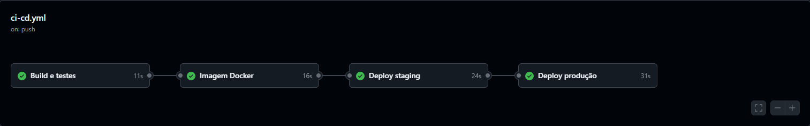
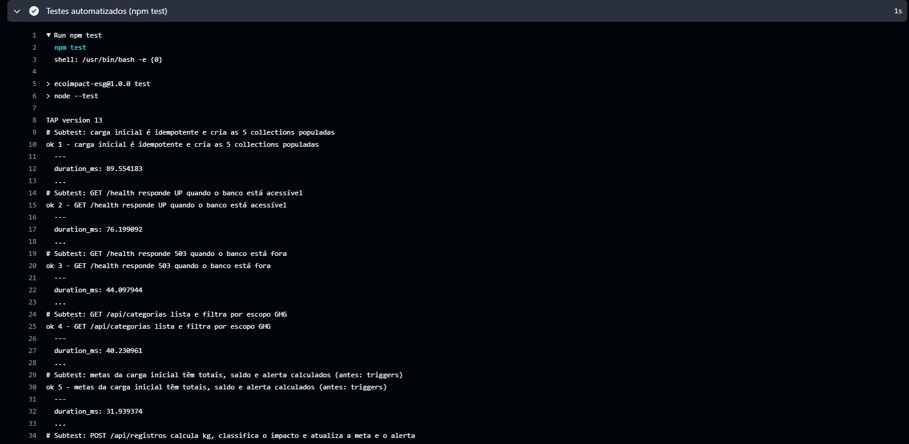
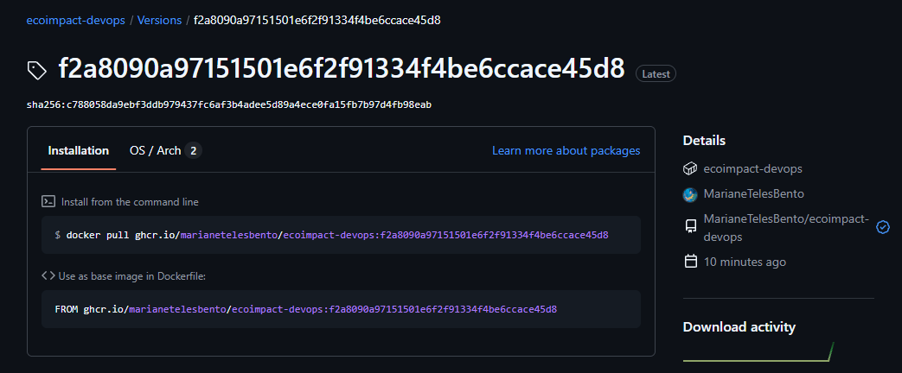
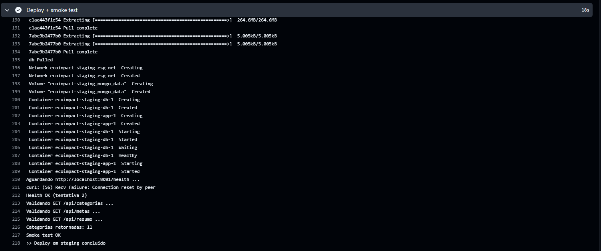
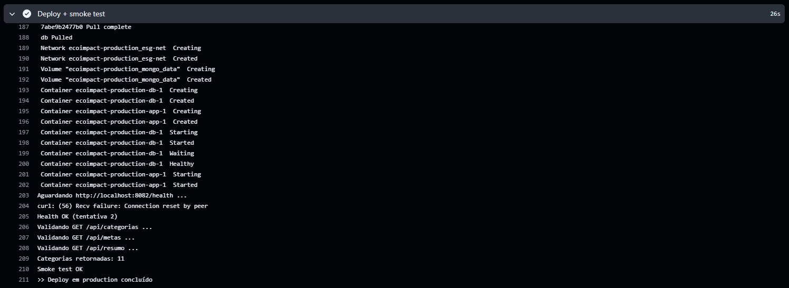
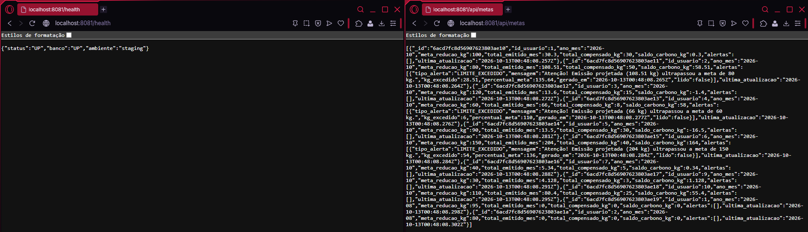
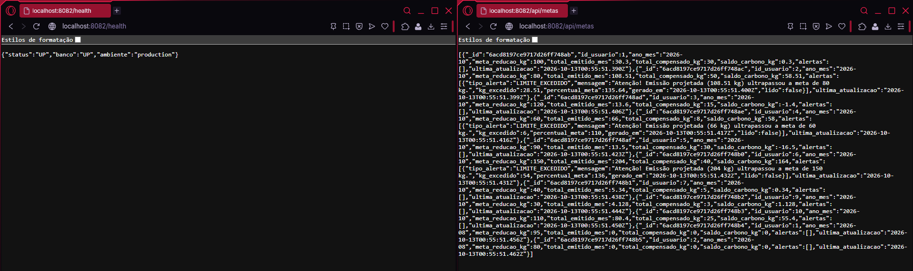

# Projeto - Cidades ESGInteligentes (EcoImpact)

**EcoImpact** é uma solução ESG de monitoramento de emissões de carbono. O modelo original foi desenvolvido em Oracle/PL-SQL (5 tabelas e 4 triggers) e depois migrado para **MongoDB** (5 collections). Neste desafio, o projeto ganhou uma **API REST (Node.js/Express)** sobre o MongoDB e um ciclo DevOps completo: pipeline CI/CD (GitHub Actions), containerização (Docker) e orquestração (Docker Compose) com ambientes de **staging** e **produção**.

**Integrantes:** _[nome completo – RM]_, _[nome completo – RM]_

## Sobre o projeto

| Collection (MongoDB) | Equivale a (Oracle) | Papel |
|---|---|---|
| `usuarios_esg` | — (nova) | Usuários/colaboradores |
| `categorias_emissao` | `CATEGORIA_EMISSAO` | Tipos de atividade e fator de emissão de CO2e, com escopo GHG |
| `registros_emissao` | `REGISTRO_EMISSAO` | Lançamentos de emissão (kg de CO2e e nível de impacto) |
| `metas_sustentabilidade` | `META_SUSTENTABILIDADE` + `ALERTA_EMISSAO` | Meta mensal, totais, saldo de carbono e alertas embutidos |
| `compensacoes_carbono` | `COMPENSACAO_CARBONO` | Ações de compensação (plantio, créditos, energia solar etc.) |

As 4 triggers PL/SQL passaram para a camada de aplicação (`src/regras.js` e `src/servico.js`):

| Trigger original | Onde está agora |
|---|---|
| `TRG_CLASSIFICA_NIVEL_IMPACTO` | `classificarNivelImpacto()` — BAIXO (< 10 kg), MEDIO (10 a 50 kg), ALTO (> 50 kg) |
| `TRG_ATUALIZA_META_EMISSAO` | `recalcularMeta()` — total emitido e saldo do mês |
| `TRG_ATUALIZA_COMPENSACAO` | `recalcularMeta()` — total compensado e saldo |
| `TRG_ALERTA_EMISSAO` | `gerarAlertaSeExcedeu()` — alerta `LIMITE_EXCEDIDO` embutido na meta |

## Estrutura do projeto

```
ecoimpact-devops/
├── Dockerfile
├── docker-compose.yml
├── .env.example
├── package.json / package-lock.json
├── env/                     # variáveis (não secretas) de staging e produção
├── scripts/                 # deploy.sh e smoke-test.sh
├── src/
│   ├── ecoimpact_mongodb_script.js   # script original de migração/CRUD (inalterado)
│   ├── server.js, app.js             # API Express
│   ├── servico.js, regras.js         # regras de negócio (antes: triggers)
│   ├── seed.js, seed-data.js         # carga inicial (mesmos dados do script original)
│   └── db.js, colecoes.js, erros.js
├── test/                    # testes automatizados (node:test)
├── support/                 # banco em memória para os testes
├── docs/
│   ├── documentacao-tecnica.pdf
│   ├── original/            # modelo Oracle/PL-SQL, MER e documento da migração
│   ├── logs/                # saídas de execução (testes e script original)
│   └── prints/              # evidências do pipeline e dos ambientes
├── README.md
└── .github/workflows/ci-cd.yml
```

## Endpoints

| Método | Rota | Descrição |
|---|---|---|
| GET | `/health` | Saúde da aplicação e do banco |
| GET | `/api/usuarios` | Lista usuários |
| GET | `/api/categorias?escopo=Escopo 3` | Lista categorias (filtros `escopo` e `ativo`) |
| GET / POST | `/api/registros` | Lista (filtro `id_usuario`) / lança emissão |
| GET | `/api/metas?ano_mes=AAAA-MM` | Metas, totais, saldo e alertas |
| GET / POST | `/api/compensacoes` | Lista / lança compensação |
| GET | `/api/resumo` | Total emitido por usuário (maior primeiro) |

Exemplos:

```bash
# Lançar uma emissão: o kg de CO2e, o nível de impacto, a meta e o alerta são calculados
curl -X POST localhost:3000/api/registros -H 'Content-Type: application/json' \
  -d '{"id_usuario":7,"id_categoria":7,"quantidade":200,"observacao":"Voo de teste"}'

# Lançar uma compensação
curl -X POST localhost:3000/api/compensacoes -H 'Content-Type: application/json' \
  -d '{"id_usuario":7,"tipo_acao":"Plantio de árvores","kg_compensado":20}'

curl localhost:3000/api/metas
```

## Como executar localmente com Docker

Pré-requisitos: Docker e Docker Compose.

```bash
# 1. Configure as variáveis de ambiente
cp .env.example .env          # edite DB_PASSWORD

# 2. Construa a imagem e suba aplicação + MongoDB
docker compose up -d --build

# 3. Verifique (a carga inicial é aplicada na primeira subida)
curl http://localhost:3000/health
curl http://localhost:3000/api/categorias

# 4. Logs e encerramento
docker compose logs -f app
docker compose down            # mantém os dados (volume mongo_data)
docker compose down -v         # remove também o volume
```

Sem Docker (Node.js 20+): `npm ci`, `npm test` (testes com banco em memória) e `npm run demo` (executa o script original de migração/CRUD).

## Pipeline CI/CD

**Ferramenta:** GitHub Actions — arquivo `.github/workflows/ci-cd.yml`.

| Etapa (job) | Quando roda | O que faz |
|---|---|---|
| `build-test` | push, pull request | `npm ci` (build), `npm test` (15 testes: regras e API) e execução do script original do EcoImpact, com o log publicado como artefato |
| `docker-image` | push em `main`/`develop` | Build da imagem com Buildx (cache) e push para o GitHub Container Registry (`ghcr.io`), com tags `latest` e o SHA do commit |
| `deploy-staging` | após a imagem | Environment `staging`: executa `scripts/deploy.sh staging` (sobe app + MongoDB via Compose com `env/staging.env`) e o smoke test |
| `deploy-production` | só em `main`, após staging | Environment `production`: executa `scripts/deploy.sh production` e o smoke test |

Como funciona:

- A **mesma imagem** (identificada pelo SHA) é promovida de staging para produção; só mudam as variáveis do ambiente.
- Cada ambiente é uma stack Compose própria (`COMPOSE_PROJECT_NAME`), com rede, volume do MongoDB e porta distintos: staging na `8081`, produção na `8082`.
- O **smoke test** (`scripts/smoke-test.sh`) espera o `/health` retornar `UP` (inclui o ping no MongoDB real) e consulta `/api/categorias`, `/api/metas` e `/api/resumo`. Se falhar, o job falha e a promoção para produção não acontece.
- **Segredos:** `STAGING_DB_PASSWORD` e `PRODUCTION_DB_PASSWORD` (Settings → Secrets and variables → Actions). Se não existirem, o pipeline usa uma senha descartável, válida apenas para o runner efêmero.
- **Aprovação manual em produção (recomendado):** em Settings → Environments → `production`, ative *Required reviewers*.
- Os deploys rodam no próprio runner do GitHub, que é efêmero. Para publicar em um servidor real, basta executar `scripts/deploy.sh` nele via SSH (ou usar `DOCKER_HOST=ssh://usuario@servidor`), mantendo o restante do pipeline igual.

## Containerização

`Dockerfile` (multi-stage):

```dockerfile
# ---------- Estágio 1: dependências de produção ----------
FROM node:20-alpine AS deps
WORKDIR /app

# Copia só os manifests primeiro para aproveitar o cache de camadas
COPY package.json package-lock.json ./
RUN npm ci --omit=dev

# ---------- Estágio 2: runtime ----------
FROM node:20-alpine
ENV NODE_ENV=production
WORKDIR /app

COPY --from=deps /app/node_modules ./node_modules
COPY package.json ./
COPY src ./src

# Usuário sem privilégios (já existe na imagem oficial do Node)
USER node

EXPOSE 3000

HEALTHCHECK --interval=15s --timeout=3s --start-period=20s --retries=5 \
  CMD wget -qO- http://localhost:3000/health | grep -q '"status":"UP"' || exit 1

CMD ["node", "src/server.js"]
```

Estratégias adotadas:

- **Multi-stage:** a imagem final leva só as dependências de produção e o código da API (sem testes, documentos nem dependências de desenvolvimento).
- **Cache de dependências:** `package.json` e `package-lock.json` são copiados antes do código; `npm ci` garante instalação reprodutível.
- **Segurança:** a aplicação roda com o usuário não-root `node`, e a imagem base é Alpine.
- **HEALTHCHECK** no contêiner, usando o `/health` da API (que faz ping no MongoDB).
- **Configuração por ambiente:** nada fixo na imagem; URI, banco, credenciais e ambiente vêm de variáveis.

`docker-compose.yml` (orquestração):

- **Serviços:** `app` (API Node.js) e `db` (MongoDB 7).
- **Rede:** `esg-net` (bridge); o MongoDB **não** publica porta no host, só a aplicação o acessa.
- **Volume:** `mongo_data` persiste os dados em `/data/db`.
- **Variáveis de ambiente:** `DB_NAME`, `DB_USER`, `DB_PASSWORD`, `APP_ENV`, `APP_PORT` e `SEED_ON_START`, lidas do `.env` (local) ou de `env/*.env` (staging/produção). O MongoDB sobe com autenticação, e `DB_PASSWORD` é obrigatória.
- **Ordem de subida:** `app` só inicia depois que o `db` passa no healthcheck (`depends_on: condition: service_healthy`).
- **Carga inicial:** com `SEED_ON_START=true`, a API popula as 5 collections na primeira subida (idempotente: não duplica dados).

## Prints do funcionamento

> Salve as capturas de tela em `docs/prints/` com os nomes abaixo, depois de executar o pipeline no seu repositório.

| Evidência | Arquivo |
|---|---|
| Pipeline concluído (visão geral) | `docs/prints/01-pipeline-geral.png` |
| Job build e testes | `docs/prints/02-build-testes.png` |
| Imagem publicada no GHCR | `docs/prints/03-imagem-ghcr.png` |
| Deploy staging | `docs/prints/04-deploy-staging.png` |
| Deploy produção | `docs/prints/05-deploy-producao.png` |
| Staging funcionando (`:8081`) | `docs/prints/06-staging-funcionando.png` |
| Produção funcionando (`:8082`) | `docs/prints/07-producao-funcionando.png` |

```markdown







```

Link da execução do pipeline: _[colar aqui a URL da aba Actions]_

Logs de execução já incluídos no projeto: `docs/logs/npm-test-local.log` (15 testes passando) e `docs/logs/script-original-local.log` (execução do script original do EcoImpact).

## Tecnologias utilizadas

- **Linguagem/Runtime:** Node.js 20, JavaScript
- **API:** Express 4
- **Banco de dados:** MongoDB 7 (driver oficial `mongodb` 6); modelo original em Oracle/PL-SQL (em `docs/original/`)
- **Testes:** `node:test` (runner nativo do Node), `mongo-mock` (banco em memória)
- **Containerização:** Docker (multi-stage), Docker Compose
- **CI/CD:** GitHub Actions, GitHub Container Registry (ghcr.io), GitHub Environments
- **Scripts:** Bash (`deploy.sh`, `smoke-test.sh`)

## Checklist de entrega

| Item | OK |
|---|---|
| Projeto compactado em .ZIP com estrutura organizada | ☑ |
| Dockerfile funcional | ☑ |
| docker-compose.yml ou arquivos Kubernetes | ☑ |
| Pipeline com etapas de build, teste e deploy | ☑ |
| README.md com instruções e prints | ☐ _(marcar após inserir os prints)_ |
| Documentação técnica com evidências (PDF ou PPT) | ☐ _(marcar após inserir os prints no PDF)_ |
| Deploy realizado nos ambientes staging e produção | ☐ _(marcar após o pipeline rodar no GitHub)_ |
